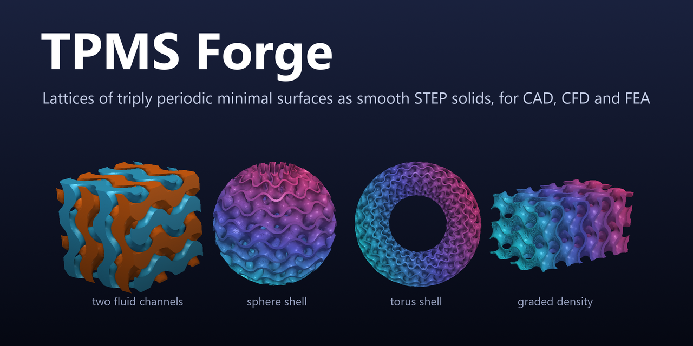
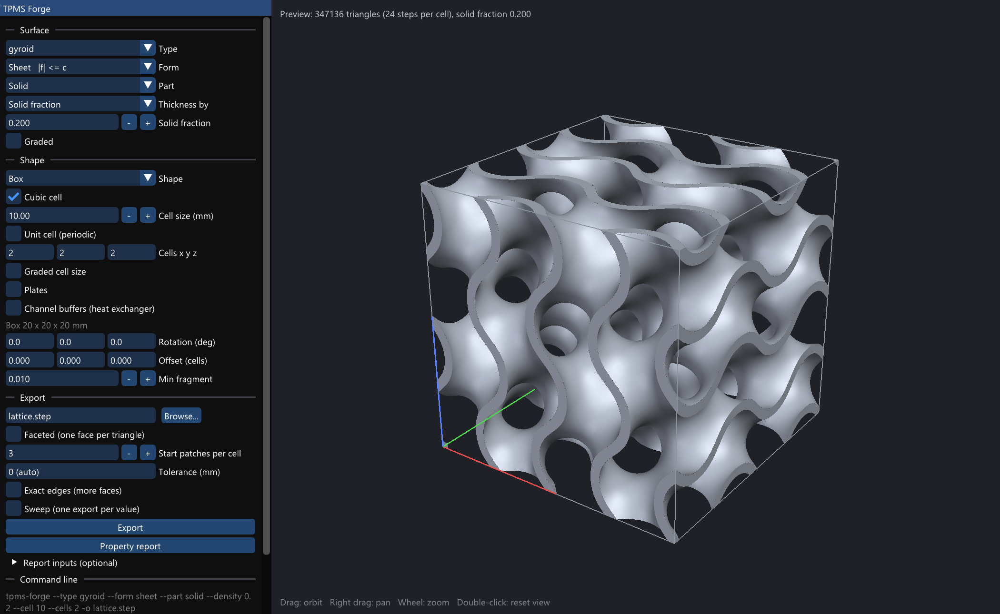

# TPMS Forge



[](https://github.com/luisvl99/TPMS-Forge/actions/workflows/ci.yml)

TPMS Forge (TPMS-F for short) turns a TPMS lattice into a STEP or STL file. TPMS stands for triply periodic minimal surface. There is a command-line tool, `tpms-forge`, and a desktop app with a live 3D preview, `tpms-forge-gui`.

**Status: v2.** STEP output has smooth bicubic B-spline faces that follow the exact surface within a set tolerance. STL output, and STEP with `--faceted`, are triangle meshes (the v0 path). The GUI offers every command-line option. Besides boxes, the lattice can fill a tube, torus shell or sphere shell with cells that follow the curvature, or a cylinder, sphere or torus cut from a straight lattice; every shape has smooth STEP. Density, wall thickness (in mm) and cell size can be graded, and a property report gives volumes, wetted area, hydraulic diameters and wall thickness for CFD and FEA. Every STEP file is checked as a valid closed solid in OpenCASCADE by the tests, and the files import into Onshape.

**Download:** Windows executables (`tpms-forge.exe` and `tpms-forge-gui.exe`, nothing to install) and the user guide are on the [Releases](../../releases/latest) page. On other systems, [build from source](#build).



The [user guide](docs/tpms-forge-user-guide.pdf) (PDF) shows every capability with pictures and walks through common workflows. Rebuild it after changes with `python tools/user_guide.py` (needs `reportlab` and `pillow`, and a built `tpms-forge-gui` for the screenshots). The banner above and the program icon come from `tools/render_images.py` (run it with the Python of the OpenCASCADE checks, which has VTK).

## GUI

Run `build/tpms-forge-gui`.

- **Left panel:** every option of the command line, grouped as Surface, Shape and Export. Numbers are typed (with − / + buttons) and clamped to valid values. Options that do not apply to the chosen output file are hidden: mesh resolution for STEP, patches and tolerance for STL.
- **Preview:** shows the solid as you change the settings. Changes to the surface, thickness, cell size, cell count or minimum fragment rebuild it on a worker thread in about half a second. Each wall (level set) is meshed on its own, so even very thin sheets show without holes; the cuts on the box faces come from a 2D grid 4 times finer. The line above the view gives the triangle count and the solid fraction (from quasi-random samples of the field, not from the preview mesh). Pieces that the export drops as fragments are still drawn. The solid is gray. The fluid (`--part void`) is blue; the fluid of a sheet is two separate channels, one on each side of the sheet (f > c and f < −c), drawn blue and red. Drag to orbit, right-drag to pan, use the wheel to zoom, and double-click to reset the view. Axes: x red, y green, z blue (z up).
- **Export:** writes the file on a worker thread. The log shows the same report as the command line.
- **Property report:** volumes, wetted area, hydraulic diameters, wall thickness and connectivity of the solid and the fluid, in a table in its own window, with Copy, Save JSON and Save CSV (see [Property report](#property-report)). `tpms-forge-gui ... --report` opens with it.
- **Command line:** the equivalent `tpms-forge` command, with a Copy button. Use it to repeat an export or to script one.

`tpms-forge-gui` also takes the `tpms-forge` options, so `tpms-forge-gui --type diamond --density 0.3 -o d.step` (for example a copied command line) opens with those settings. `tpms-forge-gui --screenshot FILE.ppm [options]` renders once the preview is final, saves the window as an image and quits (for docs and tests).

## Build

You need a C++17 compiler and CMake 3.20 or newer. OpenMP is used when the compiler has it: patch fitting, merging and meshing run on all cores. The command-line tool has no other dependencies. With MinGW, OpenMP is linked statically, so the `.exe` files run without MinGW DLLs.

`tpms-forge-gui` uses Dear ImGui 1.91.5 and GLFW 3.4. CMake downloads them at configure time (pinned versions, SHA-256 checked). Turn the GUI off with `-DTPMS_GUI=OFF` to build only the command-line tool without downloads. On Linux the GUI needs the X11 and OpenGL development files (Debian and Ubuntu: `sudo apt install xorg-dev libgl-dev`).

```bash
cmake -S . -B build -G Ninja
```

```bash
cmake --build build
```

With Visual Studio, leave out `-G Ninja` and build with `cmake --build build --config Release`. Continuous integration builds with MinGW on Windows and gcc on Linux and runs the tests there.

## Examples

Gyroid sheet, 25 % solid, 4 x 4 x 4 cells of 8 mm, written as STEP and STL:

```bash
build/tpms-forge --type gyroid --form sheet --density 0.25 --cell 8 --cells 4 -o gyroid.step -o gyroid.stl
```

Fluid domain for CFD (the box minus the solid) of the same lattice. A sheet's fluid is two channels, one on each side of the sheet, so this writes `gyroid_fluid_A.step` and `gyroid_fluid_B.step`:

```bash
build/tpms-forge --type gyroid --form sheet --density 0.25 --cell 8 --cells 4 --part void -o gyroid_fluid.step
```

Schwarz P network with an explicit iso level and non-cubic cells:

```bash
build/tpms-forge --type schwarz-p --form network --level 0.3 --cell 10 10 15 --cells 3 3 2 -o p.step
```

Graded: solid fraction from 0.1 to 0.4 along x, and cells that grow from 5 to 15 mm along x:

```bash
build/tpms-forge --density 0.1 0.4 --grade x --cell 5 --cells 4 2 2 --cell-grade x 15 -o graded.step
```

Gyroid sheet with walls 0.5 mm thick (nearly constant; the solid fraction follows):

```bash
build/tpms-forge --wall 0.5 --cell 8 --cells 4 -o gyroid_wall.step
```

Sphere shell, 15 to 25 mm radius, with cells that follow it, from 20 to 160 degrees from the +z axis:

```bash
build/tpms-forge --shape sphere-shell --radius 15 25 --cells 1 12 5 --polar 20 160 -o shell.step
```

Unit cell of a Schwarz P network for homogenization, shifted half a cell so a node sits at its center:

```bash
build/tpms-forge --unit-cell --type schwarz-p --form network --density 0.3 --shift 0.5 -o p_cell.step
```

Property report of a tube, printed and written as JSON:

```bash
build/tpms-forge --shape tube --radius 10 20 --height 20 --cells 1 8 2 --report -o tube.json
```

Fluid domain with 10 mm inlet and outlet buffers along x, for CFD:

```bash
build/tpms-forge --part void --buffers x 10 -o channel_fluid.step
```

Sandwich panel: the lattice with 1.5 mm plates on top and bottom:

```bash
build/tpms-forge --plates z 1.5 -o panel.step
```

Cross-flow heat exchanger: channel A flows along x, channel B along y, each with 10 mm inlet and outlet buffers behind 1 mm header plates. The fluid goes to `hx_fluid_A.step` and `hx_fluid_B.step`; the solid, with the plates, to `hx_solid.step`:

```bash
build/tpms-forge --part void --channel-buffers x y 10 1 -o hx_fluid.step
```

```bash
build/tpms-forge --channel-buffers x y 10 1 -o hx_solid.step
```

Batch: one model per solid fraction from 0.1 to 0.3, and one table of their reports (`gyroid_density-0.1.step`, ..., `results.csv`):

```bash
build/tpms-forge --sweep --density 0.1:0.3:0.05 -o gyroid.step -o results.csv
```

Lattice turned 30 degrees about x and 20 about y inside a box, and a hollow sphere of straight cells:

```bash
build/tpms-forge --rotate 30 20 0 -o turned.step
```

```bash
build/tpms-forge --shape sphere --radius 6 12 -o hollow.step
```

Report with mass, stiffness and pressure drop estimates for Ti-6Al-4V (4430 kg/m³, 114 GPa) and water at 0.1 m/s, as CSV:

```bash
build/tpms-forge --material 4430 114 --flow 0.1 --report -o report.csv
```

Run `build/tpms-forge --help` for all options. Run `build/tpms-forge --list` for all surface types.

## Surface types

All surfaces are level-set (nodal) approximations with period 2π. The CLI maps one period onto one unit cell.

| Name | Aliases | f(x, y, z) |
|---|---|---|
| gyroid | g | sin x cos y + sin y cos z + sin z cos x |
| schwarz-p | p, primitive | cos x + cos y + cos z |
| diamond | d, schwarz-d | sin x sin y sin z + sin x cos y cos z + cos x sin y cos z + cos x cos y sin z |
| neovius | | 3 (cos x + cos y + cos z) + 4 cos x cos y cos z |
| iwp | schoen-iwp | 2 (cos x cos y + cos y cos z + cos z cos x) − (cos 2x + cos 2y + cos 2z) |
| frd | schoen-frd | 4 cos x cos y cos z − (cos 2x cos 2y + cos 2y cos 2z + cos 2z cos 2x) |
| fischer-koch-s | fks | cos 2x sin y cos z + cos x cos 2y sin z + sin x cos y cos 2z |

## Forms and parts

- `--form sheet` is the region |f| ≤ c: a wall around the surface. The wall thickness comes from the level set, so it is not exactly constant.
- `--form network` is the region f ≤ c: one of the two channel networks.
- `--density R` finds c so that one unit cell has solid volume fraction R. It always means the solid fraction, also with `--part void`.
- `--wall T` (sheet) sets the wall thickness in mm instead. The field becomes f / |grad f| in mm, about the distance to the surface f = 0, and the sheet is where it lies within ±T/2: the thickness is nearly constant along the wall (gyroid at 0.5 mm: 0.48 to 0.49 mm, against 0.58 to 0.71 mm by solid fraction 0.2; Schwarz P, diamond and I-WP within about 10 %, FRD within about 20 %). The solid fraction follows from it and is printed. The gradient takes 6 more evaluations of f, so smooth STEP takes several times longer.
- `--part void` exports the shape minus the solid. Use it as the fluid domain for CFD. A sheet's fluid is two separate channels, f > c (A) and f < −c (B). In STEP, each channel goes to a file of its own: `-o x.step` writes `x_A.step` and `x_B.step` (smooth and `--faceted`). If a solid lies in both channels, as with `--buffers`, which join them, the tool writes one file and says why. STL keeps both channels in one file. The faceted path meshes each channel on its own, so a sheet thinner than the grid cannot join them.

## Grading

- `--density R0 R1` changes the solid fraction linearly from R0 at the start of an axis to R1 at its end. `--grade x|y|z` picks the axis (default x). For a tube or torus shell the axes are the cell axes: x radial, y around, z along the axis (tube) or around the tube (torus shell). The change is linear in the cell count along the axis. `--level C0 C1` grades the iso level instead, `--wall T0 T1` the wall thickness. On a sphere shell: x radial, y around, z from south to north.
- `--cell-grade x|y|z L1` (box) changes the cell length along that axis linearly from `--cell` at the start to L1 mm at the end. The other cell edges keep their size, so cells stretch along the axis. The box length along it is n × (L0 + L1) / 2.
- Both work with every output, and both can be combined. The tool prints the overall solid fraction the grading gives.
- Smooth STEP of a cell-graded box is built like the tube: in a box with one unit per cell, mapped to mm. The patches then follow the cells at any size.

## Unit cell

`--unit-cell` writes a periodic cell (RVE) for FEA homogenization with periodic boundary conditions:

- One cell of the box (or `--cells N` for a supercell).
- Opposite faces match exactly. The surface function reduces its phase to one cell, so a point and its copy one cell over give the same value bit for bit; the B-rep and the mesh follow. The tool checks the mesh points on each pair of faces and fails if they differ.
- Exact edges (no merging): merged faces on opposite sides would differ within `--tol`.
- Every piece is kept (`--min-fragment 0`): a small piece cut off at a corner continues in the next cell.
- No grading.

`--shift S` (or `Sx Sy Sz`, in cells, any shape) moves the lattice, so the faces cut it elsewhere: for example away from thin slivers, or with a node at the center.

`--rotate AX AY AZ` (box and trimmed shapes) turns the lattice about the origin: AX degrees about x, then AY about y, then AZ about z. Use it to print without overhangs, or to line up the lattice's stiff directions with the loads. The box keeps its faces; they cut the turned cells anywhere, which leaves small pieces at the edges, so finer patch grids are needed (the search finds them; smooth STEP takes seconds to a minute). The orientation of each patch comes from the grid (which side of the edge is inside), as for trimmed shapes: where a wall runs nearly along a grid edge, its position would twist sound patches at any grid. `python tools/check_step.py --periodic cell.step` compares the faces on opposite sides of a STEP file in OpenCASCADE (area and vertices).

## Batch runs

`--sweep OPTION V1 V2 ...` runs once per value of one option that takes one value (`--density`, `--wall`, `--level`, `--cell`, `--cells`, `--type`, `--form`, `--part`, ...), with the other options unchanged. Values are listed, or given as `FROM:TO:STEP`. Each run's files get the value in their name (`lattice_density-0.2.step`); a `.csv` output collects the property reports in one table, one line per run, with the value in a first column. In the GUI, *Sweep* under Export does the same for the thickness, cell size, cell count or surface type.

## Plates and buffers

For the box, a slab can be fused onto the faces at the start and end of one axis:

- `--plates x|y|z T [T1]` (with `--part solid`): solid plates, T mm at the start of the axis and T1 at the end (0 for none). Sandwich panels, walls of a heat exchanger.
- `--buffers x|y|z L [L1]` (with `--part void`): empty buffer zones before and after the lattice, fused with the fluid, so the flow can develop: inlet and outlet regions for CFD. A sheet's two channels meet in a buffer, so the fluid is one solid.

The slabs lie outside the lattice box, which keeps its size. In smooth STEP, the cut face under a slab becomes its complement (what the slab still shows to the other side), and the slab adds its outer face and four side faces, all planes. Reported solid fractions are of the lattice box; the volume check includes the slabs. They work with STL and faceted STEP too, not with `--unit-cell` or `--cell-grade`.

## Channel buffers (heat exchangers)

A sheet's fluid is two channels that never meet: A (f > c) and B (f < −c). `--channel-buffers A B L [T]` gives each its own inlet and outlet, for a two-fluid heat exchanger in cross flow:

- Channel A flows along axis A, channel B along axis B (x, y or z, different).
- On the two faces across its axis, each channel gets a header plate T mm thick (default 1) and, beyond it, a buffer L mm long. The plate has holes exactly where its channel opens on the face (the face's pattern, extruded), and closes the other channel there.
- `--part void` writes channel A with its holes and buffers to `NAME_A.step`, and channel B to `NAME_B.step`: one fluid region per file, ready for CFD. `--part solid` writes the lattice fused with the four plates.
- The three parts fill the box, plates and buffers without gaps or overlaps: in OpenCASCADE, the solid's and both fluids' volumes add up to within 0.2 mm³ of the 17 600 mm³ of a 20 mm box with 1 mm plates and 5 mm buffers.

Names for the setup: the buffer's end face is the port (`x-` and `x+` for channel A along x); the plates' faces and the hole walls are `wall A` or `wall B`, after the channel they face; the plate faces that close the other channel on the box face are that channel's wall. The two faces across the third axis stay open cut faces (`z-`, `z+` here): set them as walls, symmetry or periodic.

In smooth STEP each hole wall is one ruled B-spline face per run of the channel's boundary on the face (from the edge of the face back to it, or around a loop), fitted within `--tol` / 4; the plate faces and buffer faces are planes. Channel buffers need a box with a sheet, and work with STL and faceted STEP too, not with `--unit-cell`, `--cell-grade`, `--plates` or `--buffers`.

## Names in the STEP file

Solids and faces carry names, to pick boundaries in CAD, CFD and FEA:

| Name | What |
|---|---|
| `solid`, `fluid`, `fluid A`, `fluid B` | solids: the part; a sheet's fluid channels are A (f > c) and B (f < −c). More pieces get `2`, `3`, ... |
| `wall`, `wall A`, `wall B` | walls between solid and fluid; on a sheet, A and B tell which channel they face (with channel buffers also the header plates and their holes) |
| `x-`, `x+`, `y-`, `y+`, `z-`, `z+` | box faces (the outer faces of plates and buffers too: the inlet of `--buffers x` is `x-`, and with `--channel-buffers x y` channel A's ports are `x-` and `x+`) |
| `inner`, `outer`, `bottom`, `top` | tube, torus shell and sphere shell faces (a sphere shell's ends are bottom and top) |
| `side`, `bottom`, `top`, `surface` | trimmed shapes: cylinder side and ends, sphere and torus surface |

The names are written on the STEP items (`MANIFOLD_SOLID_BREP`, `ADVANCED_FACE`). Readers differ in what they import: OpenCASCADE reads them with `read.stepcaf.subshapes.name` on; a single solid often takes the file (product) name instead.

## Property report

`--report` prints the properties of the solid and the fluid (void), whatever `--part` exports. An output ending in `.json` gets the same report as JSON, one ending in `.csv` a header line and one line of values with fixed columns (rows of several runs line up, for parameter sweeps). The GUI shows it in its own window, with optional inputs and buttons to save JSON or CSV.

Optional inputs: `--material RHO [E]`, the solid's density in kg/m³ and Young's modulus in GPa; `--flow U [MU RHO]`, the superficial (inlet) velocity in m/s, and the fluid's viscosity in Pa s and density in kg/m³ (default water, 0.001 and 998).

| Value | Meaning |
|---|---|
| Solid / fluid volume | mm³, with solid fraction and porosity |
| Wetted area | area of the walls between solid and fluid, mm² (without the cut faces on the shape) |
| Specific surface | wetted area / shape volume, 1/mm and m²/m³ |
| Hydraulic diameter | 4 × fluid volume / wetted area, overall and per fluid channel |
| Channels | a sheet's fluid is two channels, f > c and f < −c, one on each side of the sheet; each gets its own volume, wetted area and hydraulic diameter |
| Wall thickness (sheet) | mean 2 × solid volume / wetted area, and the local range 2 c / \|∇f\| on the walls |
| Solid size (network) | 4 × solid volume / wetted area, like a strut diameter |
| Mass | solid volume × density, g (with `--material`) |
| Stiffness E/Es | Gibson–Ashby bounds at solid fraction φ: φ² (bending-dominated) to φ/3 (stretching-dominated); sheets usually lie near the upper value, networks near the lower. In GPa with `--material ... E`. For a real value, simulate a `--unit-cell` |
| Permeability | per fluid channel, Kozeny–Carman with Kozeny's constant 5: K = ε D_h² / 80 (ε the channel's porosity), m² |
| Pressure drop | with `--flow`, per channel: the Reynolds number on D_h and the speed in the pores, and the pressure gradient μu/K (Darcy, viscous) + 7/6 ρu² / (ε² D_h) (Ergun's inertial term, with the packed bed's particle size written through D_h), in Pa/m and over the box along the flow axis (the channel's `--channel-buffers` or `--buffers` axis, else x). Rough packed-bed estimates for comparing designs: use CFD for design |
| Pieces | each solid and fluid piece with its volume and the faces of the shape it touches |
| Connects | for each pair of opposite faces (x− / x+, inner / outer, bottom / top), whether the solid and each fluid channel connect them: flow through for CFD, load path for FEA |
| Pore size | per fluid channel, the largest sphere inside it, and for each pair of opposite faces the largest sphere that passes from one to the other (the throat that matters for powder removal and clogging). From a voxel grid in mm over the part (voxels of the mesh step, at most 8 million): each voxel's distance to the solid, then the channel's voxels joined from the farthest down until a piece touches both faces. Within about a voxel |

The values come from closed meshes at `--res` steps per cell; the fluid channels are meshed one at a time. Volumes and areas are within about 1 % at the default `--res 24`: the solid volume, wetted plus cut area of a gyroid tube and torus shell match Onshape's mass properties of the smooth STEP within 1 % and 0.3 %. The report warns when walls are thinner than a mesh step; raise `--res` then.

## Shapes

| `--shape` | Size options | Cells | Kind |
|---|---|---|---|
| `box` (default) | — | `--cell L`, `--cells nx ny nz` | box `[0, n x L]` |
| `tube` | `--radius R0 R1 --height H` | `--cells radial around axial` | cells follow the shape |
| `torus-shell` | `--radius R0 R1 --major R` | `--cells radial ring tube` | cells follow the shape |
| `sphere-shell` | `--radius R0 R1 --polar A0 A1` | `--cells radial around south-north` | cells follow the shape |
| `cylinder` | `--radius R --height H` | `--cell L` | trimmed |
| `sphere` | `--radius R` (hollow: `R0 R1`) | `--cell L` | trimmed |
| `torus` | `--radius r --major R` | `--cell L` | trimmed |

- **Cells follow the shape** (tube, torus shell, sphere shell): the lattice is built in a parameter box with one unit per cell and bent into the shape. No cell is cut on the curved walls, and the cell count around must be whole, so the lattice closes on itself. `--radial log` (default) keeps cells square: they grow with the radius. `--radial linear` keeps the radial cell size constant, so cells stretch around on the outside. The GUI shows the resulting cell sizes.
- **Sphere shell**: cells that follow a sphere cannot reach its poles: there, one point would get a different lattice for each longitude. So the shell runs from A0 to A1 degrees from the +z axis (`--polar`, default 20 160) and is open around the poles. Its ends are cones from the center, or the plane z = 0 at 90 degrees (a dome: `--polar 10 90`). Around, cells narrow toward the ends, by sin A: at 20 degrees to a third of their size at the equator. For a closed spherical part, use the trimmed `sphere`.
- **Trimmed** (cylinder, sphere, torus): a straight lattice of `--cell` cells, cut by the shape. Use this for solid shapes: bending cells around an axis or a pole would squeeze them to nothing there. `--shape sphere --radius R0 R1` is a hollow sphere: a closed spherical shell, faces `inner` and `outer`.
- Round shapes are centered at the origin with their axis along z.
- Bending stretches cells, and stretched walls are thicker, so the solid fraction differs from `--density` (which is per unit cell). The tool samples the field and prints the real value.
- Smooth STEP works for every shape. The faces where the lattice is cut are exact: cylinders and end planes for the tube and cylinder, tori for the torus shell and torus, a sphere for the sphere.

Example: a gyroid tube, 15 to 25 mm radius, 30 mm long, 12 cells around:

```bash
build/tpms-forge --shape tube --radius 15 25 --height 30 --cells 1 12 3 -o tube.step
```

## STEP options

- `--patches N` is the patch grid steps per unit cell edge to start from (default 3). Each step gives about one B-spline face per wall crossing. If the result fails a check, the tool tries N+1, N+2, … (up to 16, or N+7 if larger) and prints the value it used. FRD and Fischer-Koch S sheets need 8–11. An ungraded lattice repeats per cell, so the search runs on a single cell first, and the whole model then usually needs one try (the FRD torus shell below: 24 s → 16 s). For a trimmed shape, a step is about one cell at its outside.
- `--tol T` is the max distance in mm between a face and the exact surface (default 0.001 × the smallest cell edge; for a tube or torus shell, the smallest bent cell).
- `--exact` keeps one face per patch. Neighbor faces then share their edges exactly. Without it (the default), patches are merged into large trimmed faces, which gives 3–8 times fewer faces. Their edges lie within `--tol` of the faces instead of exactly on them (tolerant edges, as in most industrial STEP files).
- `--faceted` writes the v0 STEP (one planar face per triangle) instead.

## What the tool checks

Smooth STEP runs print the patch count used, face count, solids, solid fraction and max fit error. The tool exits with an error when the closed-shell, convergence or volume check still fails at the highest patch count.

Mesh runs (STL, `--faceted`) print the triangle count, solids, whether the mesh is closed and the solid fraction.

Both warn when:

- the solid fraction of the result is more than 5 % away from what the field gives (sampled at quasi-random points). This usually means walls thinner than the grid: raise `--res` or `--patches`.
- pieces were dropped. Small fragments cut off by the shape are dropped by default (`--min-fragment`), because a floating piece breaks an FEA or CFD setup.
- inner cavities were found inside no solid (this should not happen; the cavity is dropped). Inner cavities, for example isolated network blobs in the fluid, are written as voids of their solid (`BREP_WITH_VOIDS`). A cavity smaller than `--min-fragment` × the largest piece is filled, like a small fragment is dropped.

`ctest` in the build folder runs each surface type and the special cases (smooth STEP) and each shape (STL) once, and fails if the tool's own checks fail. When a Python with `cadquery-ocp` is found (the project's `.venv`, or `-DTPMS_PYTHON=...`), every STEP test is also read back by OpenCASCADE with the checker below, and fails if a solid is invalid or open. CMake prints `OpenCASCADE checks: ON` when it found one.

## Checking a STEP file with OpenCASCADE

[tools/check_step.py](tools/check_step.py) reads STEP files with OpenCASCADE. It reports the solid count, closed shells, face count, `BRepCheck_Analyzer` validity, volume and read time, and exits with 1 if a file is unreadable, invalid or open (or, with `--periodic`, if opposite faces differ). It needs `cadquery-ocp`, best in a `.venv` in the project folder, where `ctest` finds it:

```bash
python -m venv .venv
```

```bash
.venv/Scripts/python -m pip install cadquery-ocp
```

(`.venv/bin/python` on Linux and macOS.)

```bash
python tools/check_step.py lattice.step
```

Add `--periodic` for unit cells: it compares the faces on opposite sides. Add `--names` to list the solid and face names that OpenCASCADE's document reader finds.

Results for 2 x 2 x 2 cells at density 0.3 (sheet and network, solid and void):

- With `--exact`, all 7 surface types read as valid closed solids. The volumes match the solid fraction the tool prints within 0.0003.
- With merged faces (default), all 28 cases are valid too.

Curved shapes at density 0.3, merged faces: a tube (radius 10 to 20 mm, 10 mm long, 1 x 6 x 1 cells; all 28 cases) and a torus shell (radius 4 to 10 mm, major radius 25 mm, 1 x 12 x 4 cells; sheet solid and network void of each type):

- Everything reads as valid closed solids. The volumes match the solid fraction the tool prints: for the gyroid sheet tube, solid 2 817.5 mm³ + void 6 607.3 mm³ = 9 424.8 mm³ = π (20² − 10²) × 10.
- The Neovius network at this density is isolated blobs, so its void part has inner cavities, written as voids.

Trimmed shapes, merged faces (cylinder radius 10 mm, 20 mm long; sphere radius 10 mm; torus radius 6 mm, major radius 20 mm; 10 mm cells):

- All read as valid closed solids, with volumes within 0.05 % of the tool's: gyroid, diamond and I-WP sheets, gyroid and Schwarz P networks, solid and fluid (fluid as two files per sheet).
- They need more patches per cell than a box (4–16), so they are slower: the cylinder takes about a second, the sphere and torus seconds (gyroid torus: 7 patches per cell, 639 faces, 6 s on 20 cores).

| Faces, merged (`--exact`) | tube, 1 x 6 x 1 cells | torus shell, 1 x 12 x 4 cells |
|---|---|---|
| gyroid sheet | 354 (1 262) | 3 055 (8 582) |
| Schwarz P sheet | 171 (952) | 1 661 (6 880) |
| FRD sheet | 1 611 (10 578) | 12 244 (80 868) |

On 20 cores, the gyroid torus shell takes 4 s (49 MB) and the FRD sheet torus shell (80 868 patches) 54 s (205 MB).

| Faces, 2 x 2 x 2 cells, density 0.3 | `--exact` | merged |
|---|---|---|
| gyroid sheet / network | 1 518 / 756 | 375 / 178 |
| Schwarz P sheet / network | 1 176 / 552 | 179 / 144 |
| diamond sheet / network | 1 998 / 996 | 714 / 376 |
| I-WP sheet / network | 4 398 / 642 | 475 / 162 |
| FRD sheet / network | 13 632 / 2 868 | 1 883 / 1 231 |
| Fischer-Koch S sheet / network | 2 478 / 4 932 | 2 016 / 985 |

| Default run (gyroid sheet, 2 x 2 x 2 cells) | Faces | File | OpenCASCADE read |
|---|---|---|---|
| smooth STEP, merged | 371 | 5 MB | 1.6 s |
| smooth STEP, `--exact` | 1 506 | 5 MB | 2.0 s |
| `--faceted --res 24` | 261 396 | 196 MB | 117 s |

Merged files have 3–8 times fewer faces and are usually smaller than `--exact` files (up to 4 times; at worst 1.2 times larger): each merged face is a control net over a rectangle that includes the parts outside the face.

## Notes for NX and simulation

- Face count and file size grow with the cell count. FRD and Fischer-Koch S need finer patch grids, so they give the most faces per cell.
- Merged faces are within `--tol` of the exact surface at the patch samples and cell mid points, and within 2 × `--tol` at the points halfway between them. Finer sampling finds at most about 4 × `--tol` in between. Use a smaller `--tol` or `--exact` if that matters.
- For the faceted path, `--res` sets the grid steps per unit cell edge. Triangle count grows with `res²`. Thin sheets need a higher `res`; the density warning tells you when it is too low.
- Units are mm.

## How it works

### Smooth STEP (default for .step)

1. Split the solid boundary into walls. A network has one wall (f = c). A sheet has two (f = c and f = −c). Each wall is a smooth level set.
2. Build a quad mesh of each wall by dual contouring on a coarse grid (`--patches` steps per cell). Around every grid edge that the wall crosses, the cells around it give one quad. At the box, boundary squares and box edges join in, so quads end exactly on the box faces. A cell can hold several pieces of the wall. Its crossing edges are grouped through its faces, and a face with 4 crossings is split by the asymptotic decider. Both cells that share the face get the same answer, so the mesh stays manifold.
3. Project every quad corner onto the exact surface (Newton steps along the gradient). Corners on a box face stay in that face.
4. Sample each quad edge and project the samples onto the surface. Neighbor quads use the same samples for a shared edge.
5. Fill each quad with a Coons grid, project it onto the surface, and interpolate it with a bicubic B-spline. The boundary rows of the control net equal the edge curve, so neighbor faces meet exactly and no sewing is needed.
6. Check the distance of each face from the exact surface at the middle of every sample cell. Double the samples (4, 8, 16, 32) until it is below `--tol`.
7. Close the solid on each box face with planar faces. Their loops are the wall boundary curves plus the inside parts of the box edges.
8. Check the result: every edge is used by exactly two faces in opposite directions, all corners converged, and the enclosed volume matches a quasi-random sample of the field within 2 % of the shape volume. If a check fails, the patch grid is too coarse for some feature, so the tool tries the next `--patches` value.
9. Merge patches into large faces (skipped with `--exact`):
   - Group neighbor patches of one wall into regions. The tool keeps merging the pair with the narrowest combined normal cone, while all normals stay within 82° of the region's mean normal. A region is then a height field over the plane normal to that mean.
   - Fit one bicubic B-spline height field per region by least squares (banded Cholesky) over a rectangle along the region's principal directions, with a net shaped like the rectangle. The data are points on the exact surface: the patch samples and the cell mid points projected onto the surface. Control points are added (20 % per step) until every data point is within `tol` of the fit (distance to the tangent plane, not height: on steep parts the height difference is up to 7 times larger) and the points halfway between them within 2 × `tol` of the exact surface. A small second-difference penalty fills the parts of the rectangle outside the region.
   - A region that does not fit is grouped again with a 15° smaller cone. A region fails if it folds over itself, touches itself at a vertex, has more than one outer loop, or its boundary comes within 2 × `tol` of itself: a sliver, a pinch, or a spike that turns back at a vertex. On the fitted surface, which is only within `tol` of the exact one, the curves of those parts would cross. A single patch that fails keeps its own surface.
   - Join the patch edges between the same two faces into one B-spline curve within `tol` / 4. Chains end at kinks sharper than 30°: one curve cannot follow a corner. A chain of a single patch edge keeps that edge's own curve: refitting it gains nothing, and within `tol` / 4 it could cross a neighbor edge where a face is a sliver (a wall that just pokes through a cut face). Zero-length edges (two corners on one point, e.g. on a mirror plane) are collapsed.
   - The STEP uncertainty is set to `tol`, so readers accept the edge gaps.
10. Write STEP AP214: `B_SPLINE_SURFACE_WITH_KNOTS` faces, `B_SPLINE_CURVE_WITH_KNOTS` edges, `PLANE` caps with `LINE` edges on the box.

For a tube, torus shell or sphere shell, the same steps run in the parameter box (one unit per cell):

- Corners and samples are projected onto the surface in the parameter box, then mapped to mm. The B-splines are fitted to the mapped samples, and the fit error is measured in mm.
- The faces where the parameter box wraps around (the seam) get no caps. The field repeats there, so both copies of the seam get the same patches. After fitting, the far copy of every seam vertex and edge is welded to the near one.
- Caps lie on exact `CYLINDRICAL_SURFACE`s (tube walls), `TOROIDAL_SURFACE`s (torus shell walls), `SPHERICAL_SURFACE`s and `CONICAL_SURFACE`s (sphere shell walls and ends) or `PLANE`s (tube ends, a sphere shell's end at 90 degrees). Their edges along the shape's box edges (circles and straight lines) are B-spline curves within `tol` / 4, so the STEP uncertainty is `tol`. A curved cap keeps the seam as an edge it uses twice, as CAD seams are. A tube end is joined across the seam into an annulus with holes.
- Volumes use a flux in the parameter box: Phi(u) with dPhi/du = det J, the volume stretch of the mapping. The flux through the closed patch and cap surfaces is the volume in mm, exact up to the face samples. On the seam the flux is zero, so no cap is needed there.

For a cylinder, sphere or torus (trimmed shapes), the same steps run in a parameter box in cylindrical, spherical or toroidal coordinates (radius from the axis, the center line or the center, and angles), and the straight lattice is evaluated at the mapped point:

- The outside of the parameter box becomes the caps: `CYLINDRICAL_SURFACE` and end `PLANE`s, `SPHERICAL_SURFACE`, `TOROIDAL_SURFACE`. The angles wrap around as seams, as for the tube.
- The faces at radius 0, and the sphere's poles, map to a line or a point. They get no caps: their vertices that map to one point are welded, and their zero-length edges dropped, so the patches there become triangles.
- A cap around a pole of the sphere is written with its boundary circle alone, without the seam: CAD readers add the seam and the pole themselves.
- The parameter box is distorted near the axis, so coarse patch grids fold there more often, and the search ends at higher patch counts than for a box (see the table below).

Inner cavities: each shell with negative volume goes to the smallest solid around it (the parity of a ray through the patches and caps; with one solid, that one) and is written as a void of it, an `ORIENTED_CLOSED_SHELL` in a `BREP_WITH_VOIDS`.

Channel buffers replace the caps on the faces across each channel's axis. The other channel's openings there are capped (facing the plate). The channel's own boundary on the face is walked as its cap would be, in runs from the edge of the face back to it, or loops; each run is fitted with one cubic curve within `tol` / 4 and extruded through the plate into a ruled B-spline face (degree 3 × 1) whose bottom edges are the walls' own edges. The run's edges, moved by the plate thickness, bound the plate's outer face (or the buffer's inner face) together with one line per stretch of the face's edge that the channel does not open on; the plate's sides and the buffer's sides share those lines and reach down to the face where a hole meets them.

### Faceted STEP and STL

1. Sample the field on a regular grid. The field is |f| − c (sheet) or f − c (network); `--part void` uses its negative. The grid covers the box; for a tube or torus shell, the parameter box (one unit per cell); for a trimmed shape, its bounds plus one grid step, with the field cut by the shape (the larger of the two values).
2. Extract the surface with marching tetrahedra. Each grid cube is split into 6 tetrahedra along its main diagonal. The split is the same in every cube, so no ambiguous cases occur and neighboring cubes share edges exactly.
3. Close the solid with planar caps on the box faces. Each face square is split along the same diagonal as the tetrahedra and clipped to the inside region. The caps reuse the surface vertices, so the mesh is watertight. Axes that wrap around (around a tube; around and along a torus shell) get no caps: their two ends are welded instead.
4. Keep each surface vertex at least 2 % of a grid edge away from grid nodes. This prevents near-zero edges and does not change the mesh topology.
5. For a tube or torus shell, map every vertex from the parameter box to mm. The mapping keeps orientation, so the mesh stays closed and outward.
6. Split the mesh into connected solids and drop small fragments. An inner cavity stays with the solid around it (ray parity), and a tiny one is filled.
7. Write STEP AP214 directly: `MANIFOLD_SOLID_BREP` (`BREP_WITH_VOIDS` with cavities) → `CLOSED_SHELL` → `ADVANCED_FACE` on a `PLANE` per triangle, with shared `EDGE_CURVE`s. STL is binary.

## Roadmap

- **v1 (done):** smooth STEP with B-spline faces, error checked against the exact implicit function, shared boundary curves.
- **v1 merged faces (done):** 3–8 times fewer faces through trimmed height-field regions.
- **Next for v1:** test import in NX (Onshape imports the files).
- **v2 (done):** GUI with every command-line option and a live preview.
- **Curved shapes, phase 1 (done):** tube and torus shell with cells that follow the shape; trimmed cylinder, sphere and torus; preview, STL and faceted STEP.
- **Curved shapes, phase 2 (done):** smooth STEP for the tube and torus shell, with exact cylinder, torus and plane caps.
- **Graded lattices and property report (done):** graded solid fraction or level along an axis, graded cell size in a box, and the report.
- **Unit cell (done):** periodic cells for homogenization, lattice offset.
- **Names, plates and buffers (done):** named solids and faces; plates and inlet/outlet buffers on the box.
- **Inner cavities, smooth trimmed shapes, faster search (done):** voids (`BREP_WITH_VOIDS`) in every STEP and STL; smooth STEP for the cylinder, sphere and torus; the patch search on one cell first; OpenCASCADE checks in `ctest`.
- **Heat exchangers and report estimates (done):** channel buffers (separate inlets and outlets per fluid channel, with header plates); mass, stiffness bounds, permeability and pressure drop estimates; CSV reports.
- **Wall thickness and sphere shell (done):** sheets with a set wall thickness in mm; a sphere shell with cells that follow it.
- **Batch runs, rotation, pores (done):** `--sweep`; rotated lattices; a hollow sphere; pore and throat sizes in the report; exact gradients (wall thickness 3 to 4 times faster).
- **Next:** test the names in NX; custom formulas and more surfaces.
- **v3:** infill of an arbitrary part, cylindrical and spherical lattices, exact minimal surfaces (Weierstrass) as an option.

## License

MIT: see [LICENSE](LICENSE). `tpms-forge-gui` includes [Dear ImGui](https://github.com/ocornut/imgui) (MIT) and [GLFW](https://www.glfw.org) (zlib license); the release zip has their license texts.
